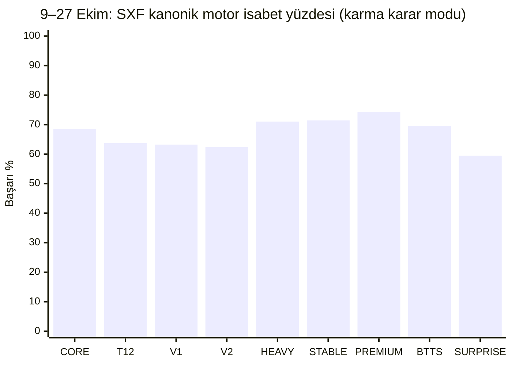

# CAPİTALE SXF — Sinyal Performansları

**9–27 Ekim 2026 · 19 gün · 9–26 Ekim 16:00–24:00 TSİ T-6/T-8 tarihsel araştırma; 27 Ekim 19:00–24:00 TSİ canlı sohbet DYNAMIC_AS_OF_V04 + ayrı T-8 deneysel uyarlama**

> **Karma dönem uyarısı:** 9–26 Ekim sonuçları daha sonra oluşturulmuş T-6/T-8 araştırma taramalarıdır. 27 Ekim raporu ise farklı saat aralığında ve farklı karar anında yapılmış **canlı sohbet taramasının maç sonrası GitHub aktarımıdır**. Oranları ve sinyal sayılarını birleştirirken bu farkı koru; sonuçlar tek tip tarihsel backtest veya geleceğe kalibre başarı oranı değildir. Bu rapor **isabet ve SXF oranını** ölçer; ROI/unit hesabı yapmaz.

**Toplam:** **19 gün · 506 farklı piyasa seçimi · 505 sonuçlanan · 1 doğrulanamayan · 454 günlük toplam sinyalli maç kaydı.** 506 seçimden 505'i kanonik ana SXF taramalarından, 1'i yalnızca T-8 EKOL 3'ten gelen Frankfurt seçimidir; diğer iki gölge seçim tekrar sayılmaz. **903 kanonik motor etiketi**, ayrıca 3 gölge etiketi.

## 1. Genel motor başarıları

| Motor | Sinyal | Sonuçlanan | Başarılı | Başarı % | Ortalama SXF oranı |
|---|---:|---:|---:|---:|---:|
| **EARLY CORE** | 89 | 89 | 61 | %68,5 | 1,79 |
| **EARLY T12** | 175 | 174 | 111 | %63,8 | 1,78 |
| **Concentration V1** | 194 | 193 | 122 | %63,2 | 1,76 |
| **Concentration V2** | 149 | 149 | 93 | %62,4 | 1,74 |
| **HEAVY 1X2** | 69 | 69 | 49 | %71,0 | 1,75 |
| **STABLE Üst 2.5** | 35 | 35 | 25 | %71,4 | 1,60 |
| **PREMIUM Üst 2.5** | 35 | 35 | 26 | %74,3 | 1,59 |
| **KG VAR / BTTS YES** | 46 | 46 | 32 | %69,6 | 1,74 |
| **SURPRISE (yenilmeme)** | 111 | 111 | 66 | %59,5 | 3,35 |

**Ortalama oran**, sonuçlanmış motor sinyallerinin karar anında görülen SXF ondalık oranlarının aritmetik ortalamasıdır; 15 Ekim'deki doğrulanamayan sinyal (1,94) başarı/settled ortalamasına katılmaz. Motorlar örtüşür (V2/V1, HEAVY vs). **T-8 deneysel motorlar bu kanonik motor tablosuna yeni bağımsız oy olarak eklenmez.** SURPRISE başarı ölçütü yenilmeme, oranı ise takım galibiyeti fiyatıdır.

## Motor başarı oranlarının grafiği

**Not:** SURPRISE kaybetmeme olarak sonuçlandırılır; 1X2 galibiyetiyle aynı bet türü değildir. 27 Ekim'in farklı tarama modu sebebiyle bu birleşik grafik açıklayıcıdır.

## 2. Tekilleştirilmiş piyasa başarısı

| Piyasa | Sonuçlanan / sinyal | Başarılı | Başarı % | Ortalama SXF oranı |
|---|---:|---:|---:|---:|
| 1X2 takım galibiyeti | 278/279 | 182 | %65,5 | 1,80 |
| Üst 2.5 | 70/70 | 51 | %72,9 | 1,59 |
| KG VAR | 46/46 | 32 | %69,6 | 1,74 |
| SURPRISE (yenilmeme) | 111/111 | 66 | %59,5 | 3,35 |

**Kanonik motor etiketleri** bağımsız seçim değildir. 27 Ekim'deki Frankfurt EKOL 3 ek 1X2 seçimi piyasa bazında bir defa sayılmıştır. Gölge motorların **1/1 OVER_STRONG T-8 ve 2/2 EKOL 3 T-8** başarısı (3 etiket) sadece ayrı deneysel tabloda; bunların ikisi zaten ana seçimlerde bulunduğundan 3 yeni seçim eklenmez.

## 3. Gün gün motor başarı yüzdeleri

> **27 Ekim kanonik motor sayıları**, farklı dynamic AS_OF kohortundan gelir. T8 gölge sinyalleri aşağıda ayrıca.

| Gün | CORE | T12 | V1 | V2 | HEAVY |
|---|---:|---:|---:|---:|---:|
| [09 Eki](2026/10/09/sxf-research-2026-10-09-t6-fallback-t8-16to24-v1-outcome-v1.md) | 0/2 (%0,0) | 1/4 (%25,0) | 8/10 (%80,0) | 6/7 (%85,7) | 0/1 (%0,0) |
| [10 Eki](2026/10/10/sxf-research-2026-10-10-t6-fallback-t8-16to24-v1-outcome-v1.md) | 6/7 (%85,7) | 12/17 (%70,6) | 10/15 (%66,7) | 6/9 (%66,7) | 2/2 (%100,0) |
| [11 Eki](2026/10/11/sxf-research-2026-10-11-t6-fallback-t8-16to24-v1-outcome-v1.md) | 6/6 (%100,0) | 7/7 (%100,0) | 10/10 (%100,0) | 8/8 (%100,0) | 3/3 (%100,0) |
| [12 Eki](2026/10/12/sxf-research-2026-10-12-t6-fallback-t8-16to24-v2-outcome-v1.md) | 1/1 (%100,0) | 4/4 (%100,0) | 5/6 (%83,3) | 4/4 (%100,0) | 3/3 (%100,0) |
| [13 Eki](2026/10/13/sxf-research-2026-10-13-t6-fallback-t8-16to24-v1-outcome-v1.md) | 5/7 (%71,4) | 3/7 (%42,9) | 3/5 (%60,0) | 3/3 (%100,0) | 2/3 (%66,7) |
| [14 Eki](2026/10/14/sxf-research-2026-10-14-t6-fallback-t8-16to24-v1-outcome-v1.md) | 5/8 (%62,5) | 4/5 (%80,0) | 3/4 (%75,0) | 3/4 (%75,0) | 3/3 (%100,0) |
| [15 Eki](2026/10/15/sxf-research-2026-10-15-t6-fallback-t8-16to24-v1-outcome-v2.md) | 4/6 (%66,7) | 10/15 (%66,7) | 5/10 (%50,0) | 3/8 (%37,5) | 3/5 (%60,0) |
| [16 Eki](2026/10/16/sxf-research-2026-10-16-t6-fallback-t8-16to24-v1-outcome-v1.md) | — | 3/4 (%75,0) | 7/9 (%77,8) | 4/6 (%66,7) | 2/3 (%66,7) |
| [17 Eki](2026/10/17/sxf-research-2026-10-17-t6-fallback-t8-16to24-v1-outcome-v1.md) | 5/7 (%71,4) | 12/17 (%70,6) | 10/16 (%62,5) | 10/16 (%62,5) | 6/8 (%75,0) |
| [18 Eki](2026/10/18/sxf-research-2026-10-18-t6-fallback-t8-16to24-v1-outcome-v1.md) | 4/5 (%80,0) | 7/11 (%63,6) | 9/17 (%52,9) | 8/13 (%61,5) | 6/6 (%100,0) |
| [19 Eki](2026/10/19/sxf-research-2026-10-19-t6-fallback-t8-16to24-v1-outcome-v1.md) | 1/1 (%100,0) | 2/3 (%66,7) | 4/5 (%80,0) | 3/4 (%75,0) | — |
| [20 Eki](2026/10/20/sxf-research-2026-10-20-t6-fallback-t8-16to24-v1-outcome-v1.md) | 2/4 (%50,0) | 6/13 (%46,2) | 6/14 (%42,9) | 6/14 (%42,9) | 2/5 (%40,0) |
| [21 Eki](2026/10/21/sxf-research-2026-10-21-t6-fallback-t8-16to24-v1-outcome-v1.md) | 1/2 (%50,0) | 1/3 (%33,3) | 1/1 (%100,0) | 1/1 (%100,0) | 1/1 (%100,0) |
| [22 Eki](2026/10/22/sxf-research-2026-10-22-t6-fallback-t8-16to24-v1-outcome-v1.md) | 5/9 (%55,6) | 12/17 (%70,6) | 10/17 (%58,8) | 9/15 (%60,0) | 6/9 (%66,7) |
| [23 Eki](2026/10/23/sxf-research-2026-10-23-t6-fallback-t8-16to24-v1-outcome-v1.md) | 0/2 (%0,0) | 0/4 (%0,0) | 5/10 (%50,0) | 2/5 (%40,0) | 1/3 (%33,3) |
| [24 Eki](2026/10/24/sxf-research-2026-10-24-t6-fallback-t8-16to24-v1-outcome-v1.md) | 4/6 (%66,7) | 8/17 (%47,1) | 10/19 (%52,6) | 6/15 (%40,0) | 4/5 (%80,0) |
| [25 Eki](2026/10/25/sxf-research-2026-10-25-t6-fallback-t8-16to24-v1-outcome-v1.md) | 6/10 (%60,0) | 10/14 (%71,4) | 11/16 (%68,8) | 8/12 (%66,7) | 5/8 (%62,5) |
| [26 Eki](2026/10/26/sxf-research-2026-10-26-t6-fallback-t8-16to24-v1-outcome-v1.md) | 4/4 (%100,0) | 4/4 (%100,0) | 3/4 (%75,0) | 1/1 (%100,0) | — |
| [27 Eki](2026/10/27/sxf-2026-10-27-dynamic-asof-145728-chat-outcome-v1.md) | 2/2 (%100,0) | 5/8 (%62,5) | 2/5 (%40,0) | 2/4 (%50,0) | 0/1 (%0,0) |

| Gün | STABLE | PREMIUM | KG VAR | SURPRISE (yenilmeme) |
|---|---:|---:|---:|---:|
| [09 Eki](2026/10/09/sxf-research-2026-10-09-t6-fallback-t8-16to24-v1-outcome-v1.md) | 1/2 (%50,0) | 1/3 (%33,3) | 3/3 (%100,0) | 3/4 (%75,0) |
| [10 Eki](2026/10/10/sxf-research-2026-10-10-t6-fallback-t8-16to24-v1-outcome-v1.md) | 3/3 (%100,0) | 5/6 (%83,3) | 2/4 (%50,0) | 10/12 (%83,3) |
| [11 Eki](2026/10/11/sxf-research-2026-10-11-t6-fallback-t8-16to24-v1-outcome-v1.md) | 2/2 (%100,0) | 1/1 (%100,0) | 3/3 (%100,0) | 5/6 (%83,3) |
| [12 Eki](2026/10/12/sxf-research-2026-10-12-t6-fallback-t8-16to24-v2-outcome-v1.md) | 1/1 (%100,0) | — | 2/2 (%100,0) | — |
| [13 Eki](2026/10/13/sxf-research-2026-10-13-t6-fallback-t8-16to24-v1-outcome-v1.md) | 2/2 (%100,0) | — | 1/2 (%50,0) | 3/4 (%75,0) |
| [14 Eki](2026/10/14/sxf-research-2026-10-14-t6-fallback-t8-16to24-v1-outcome-v1.md) | 3/3 (%100,0) | 1/3 (%33,3) | 1/1 (%100,0) | 1/5 (%20,0) |
| [15 Eki](2026/10/15/sxf-research-2026-10-15-t6-fallback-t8-16to24-v1-outcome-v2.md) | 3/3 (%100,0) | 2/2 (%100,0) | 1/1 (%100,0) | 0/2 (%0,0) |
| [16 Eki](2026/10/16/sxf-research-2026-10-16-t6-fallback-t8-16to24-v1-outcome-v1.md) | — | — | 3/4 (%75,0) | 1/4 (%25,0) |
| [17 Eki](2026/10/17/sxf-research-2026-10-17-t6-fallback-t8-16to24-v1-outcome-v1.md) | 0/1 (%0,0) | 2/3 (%66,7) | 1/1 (%100,0) | 6/9 (%66,7) |
| [18 Eki](2026/10/18/sxf-research-2026-10-18-t6-fallback-t8-16to24-v1-outcome-v1.md) | 2/3 (%66,7) | 4/4 (%100,0) | 2/3 (%66,7) | 5/7 (%71,4) |
| [19 Eki](2026/10/19/sxf-research-2026-10-19-t6-fallback-t8-16to24-v1-outcome-v1.md) | 1/1 (%100,0) | — | 1/1 (%100,0) | 2/3 (%66,7) |
| [20 Eki](2026/10/20/sxf-research-2026-10-20-t6-fallback-t8-16to24-v1-outcome-v1.md) | — | 2/2 (%100,0) | 2/3 (%66,7) | 1/2 (%50,0) |
| [21 Eki](2026/10/21/sxf-research-2026-10-21-t6-fallback-t8-16to24-v1-outcome-v1.md) | 1/2 (%50,0) | 2/2 (%100,0) | 1/2 (%50,0) | 1/1 (%100,0) |
| [22 Eki](2026/10/22/sxf-research-2026-10-22-t6-fallback-t8-16to24-v1-outcome-v1.md) | 3/4 (%75,0) | 2/2 (%100,0) | 1/3 (%33,3) | 4/5 (%80,0) |
| [23 Eki](2026/10/23/sxf-research-2026-10-23-t6-fallback-t8-16to24-v1-outcome-v1.md) | — | — | 2/2 (%100,0) | 1/2 (%50,0) |
| [24 Eki](2026/10/24/sxf-research-2026-10-24-t6-fallback-t8-16to24-v1-outcome-v1.md) | 0/1 (%0,0) | 2/5 (%40,0) | 3/5 (%60,0) | 13/19 (%68,4) |
| [25 Eki](2026/10/25/sxf-research-2026-10-25-t6-fallback-t8-16to24-v1-outcome-v1.md) | 2/5 (%40,0) | — | 0/1 (%0,0) | 4/12 (%33,3) |
| [26 Eki](2026/10/26/sxf-research-2026-10-26-t6-fallback-t8-16to24-v1-outcome-v1.md) | 0/1 (%0,0) | 1/1 (%100,0) | 0/1 (%0,0) | 2/7 (%28,6) |
| [27 Eki](2026/10/27/sxf-2026-10-27-dynamic-asof-145728-chat-outcome-v1.md) | 1/1 (%100,0) | 1/1 (%100,0) | 3/4 (%75,0) | 4/7 (%57,1) |

### 27 Ekim T-8 deneysel motor izleme

| Motor | İsabet | Kullanılan seçimler |
|---|---:|---|
| OVER_STRONG T-8 (uyarlanmış) | 1/1 | Sassuolo – Lazio Üst 2.5 (ana STABLE ile aynı bahis, T8 farklı oran) |
| EKOL 3 T-8 (uyarlanmış) | 2/2 | Hamburger SV – Frankfurt (ek 1X2), MK Dons – Bromley (ana V1/V2 ile aynı bahis) |

Bu iki adayın T-8 sonuçları, T-6 tarihsel geçmiş motor yüzdeleriyle aynı yöntemmiş gibi birleştirilmez.

## 4. Günlük karşılaştırma: seçim ve piyasa başarısı

| Tarih | Seçim | Sonuçlanan | 1X2 | Üst 2.5 | KG VAR | SURPRISE (yenilmeme) |
|---|---:|---:|---|---|---|---|
| 09 Ekim | 24 | 24 | 8/12 | 2/5 | 3/3 | 3/4 |
| 10 Ekim | 52 | 52 | 20/27 | 8/9 | 2/4 | 10/12 |
| 11 Ekim | 26 | 26 | 14/14 | 3/3 | 3/3 | 5/6 |
| 12 Ekim | 11 | 11 | 7/8 | 1/1 | 2/2 | 0/0 |
| 13 Ekim | 19 | 19 | 6/11 | 2/2 | 1/2 | 3/4 |
| 14 Ekim | 22 | 22 | 6/10 | 4/6 | 1/1 | 1/5 |
| 15 Ekim | 25 | 24 | 10/16 | 5/5 | 1/1 | 0/2 |
| 16 Ekim | 19 | 19 | 8/11 | 0/0 | 3/4 | 1/4 |
| 17 Ekim | 38 | 38 | 16/24 | 2/4 | 1/1 | 6/9 |
| 18 Ekim | 36 | 36 | 10/19 | 6/7 | 2/3 | 5/7 |
| 19 Ekim | 12 | 12 | 6/7 | 1/1 | 1/1 | 2/3 |
| 20 Ekim | 26 | 26 | 9/19 | 2/2 | 2/3 | 1/2 |
| 21 Ekim | 10 | 10 | 1/3 | 3/4 | 1/2 | 1/1 |
| 22 Ekim | 35 | 35 | 13/21 | 5/6 | 1/3 | 4/5 |
| 23 Ekim | 16 | 16 | 5/12 | 0/0 | 2/2 | 1/2 |
| 24 Ekim | 54 | 54 | 13/24 | 2/6 | 3/5 | 13/19 |
| 25 Ekim | 39 | 39 | 15/21 | 2/5 | 0/1 | 4/12 |
| 26 Ekim | 18 | 18 | 7/8 | 1/2 | 0/1 | 2/7 |
| 27 Ekim | 24 | 24 | 8/11 | 2/2 | 3/4 | 4/7 |

## 5. Her günün ortalama motor SXF oranı

Her hücre yalnız sonuçlanan sinyallerin ortalama oranıdır; `—` ilgili gün için sonuçlanan sinyal olmadığını gösterir.

| Gün | CORE | T12 | V1 | V2 | HEAVY | STABLE | PREMIUM | BTTS | SURPRISE |
|---|---:|---:|---:|---:|---:|---:|---:|---:|---:|
| 09 Eki | 1,45 | 1,64 | 1,72 | 1,64 | 1,51 | 1,42 | 1,54 | 1,75 | 3,36 |
| 10 Eki | 1,90 | 1,75 | 1,86 | 1,82 | 2,26 | 1,58 | 1,60 | 1,70 | 3,39 |
| 11 Eki | 1,85 | 1,85 | 1,67 | 1,67 | 1,66 | 1,63 | 1,72 | 1,72 | 3,46 |
| 12 Eki | 1,61 | 1,84 | 1,92 | 1,96 | 2,02 | 1,57 | — | 1,68 | — |
| 13 Eki | 1,85 | 2,09 | 1,72 | 1,58 | 1,78 | 1,66 | — | 1,76 | 3,45 |
| 14 Eki | 1,92 | 1,77 | 1,62 | 1,62 | 1,64 | 1,61 | 1,53 | 1,80 | 3,03 |
| 15 Eki | 1,90 | 1,80 | 1,83 | 1,83 | 1,86 | 1,67 | 1,60 | 1,78 | 2,93 |
| 16 Eki | — | 1,98 | 1,75 | 1,82 | 1,97 | — | — | 1,77 | 3,69 |
| 17 Eki | 1,72 | 1,72 | 1,75 | 1,75 | 1,69 | 1,80 | 1,65 | 1,77 | 3,17 |
| 18 Eki | 1,94 | 1,76 | 1,79 | 1,75 | 1,76 | 1,61 | 1,58 | 1,70 | 3,46 |
| 19 Eki | 1,59 | 1,83 | 1,60 | 1,62 | — | 1,64 | — | 1,76 | 3,37 |
| 20 Eki | 1,66 | 1,84 | 1,76 | 1,76 | 1,74 | — | 1,52 | 1,71 | 3,18 |
| 21 Eki | 1,62 | 1,52 | 1,94 | 1,94 | 1,94 | 1,40 | 1,64 | 1,82 | 3,20 |
| 22 Eki | 1,73 | 1,66 | 1,69 | 1,68 | 1,64 | 1,64 | 1,49 | 1,78 | 3,32 |
| 23 Eki | 1,54 | 1,87 | 1,75 | 1,79 | 1,82 | — | — | 1,68 | 2,95 |
| 24 Eki | 1,84 | 1,97 | 1,85 | 1,86 | 1,68 | 1,62 | 1,54 | 1,76 | 3,45 |
| 25 Eki | 1,77 | 1,68 | 1,75 | 1,70 | 1,67 | 1,63 | — | 1,88 | 3,22 |
| 26 Eki | 1,65 | 1,63 | 1,76 | 1,54 | — | 1,41 | 1,70 | 1,67 | 3,49 |
| 27 Eki | 1,76 | 1,71 | 1,64 | 1,60 | 1,46 | 1,76 | 1,76 | 1,69 | 3,36 |

## 6. Günlük skor kanıtları ve seçime özel raporlar

- **09 Ekim:** [Tüm skorlar, kazanıp/kaybetme ve günlük motor performansı](2026/10/09/sxf-research-2026-10-09-t6-fallback-t8-16to24-v1-outcome-v1.md) · [Orijinal sinyaller](2026/10/09/sxf-research-2026-10-09-t6-fallback-t8-16to24-v1.md)
- **10 Ekim:** [Tüm skorlar, kazanıp/kaybetme ve günlük motor performansı](2026/10/10/sxf-research-2026-10-10-t6-fallback-t8-16to24-v1-outcome-v1.md) · [Orijinal sinyaller](2026/10/10/sxf-research-2026-10-10-t6-fallback-t8-16to24-v1.md)
- **11 Ekim:** [Tüm skorlar, kazanıp/kaybetme ve günlük motor performansı](2026/10/11/sxf-research-2026-10-11-t6-fallback-t8-16to24-v1-outcome-v1.md) · [Orijinal sinyaller](2026/10/11/sxf-research-2026-10-11-t6-fallback-t8-16to24-v1.md)
- **12 Ekim:** [Tüm skorlar, kazanıp/kaybetme ve günlük motor performansı](2026/10/12/sxf-research-2026-10-12-t6-fallback-t8-16to24-v2-outcome-v1.md) · [Orijinal sinyaller](2026/10/12/sxf-research-2026-10-12-t6-fallback-t8-16to24-v2.md)
- **13 Ekim:** [Tüm skorlar, kazanıp/kaybetme ve günlük motor performansı](2026/10/13/sxf-research-2026-10-13-t6-fallback-t8-16to24-v1-outcome-v1.md) · [Orijinal sinyaller](2026/10/13/sxf-research-2026-10-13-t6-fallback-t8-16to24-v1.md)
- **14 Ekim:** [Tüm skorlar, kazanıp/kaybetme ve günlük motor performansı](2026/10/14/sxf-research-2026-10-14-t6-fallback-t8-16to24-v1-outcome-v1.md) · [Orijinal sinyaller](2026/10/14/sxf-research-2026-10-14-t6-fallback-t8-16to24-v1.md)
- **15 Ekim:** [Tüm skorlar, kazanıp/kaybetme ve günlük motor performansı](2026/10/15/sxf-research-2026-10-15-t6-fallback-t8-16to24-v1-outcome-v2.md) · [Orijinal sinyaller](2026/10/15/sxf-research-2026-10-15-t6-fallback-t8-16to24-v1.md)
- **16 Ekim:** [Tüm skorlar, kazanıp/kaybetme ve günlük motor performansı](2026/10/16/sxf-research-2026-10-16-t6-fallback-t8-16to24-v1-outcome-v1.md) · [Orijinal sinyaller](2026/10/16/sxf-research-2026-10-16-t6-fallback-t8-16to24-v1.md)
- **17 Ekim:** [Tüm skorlar, kazanıp/kaybetme ve günlük motor performansı](2026/10/17/sxf-research-2026-10-17-t6-fallback-t8-16to24-v1-outcome-v1.md) · [Orijinal sinyaller](2026/10/17/sxf-research-2026-10-17-t6-fallback-t8-16to24-v1.md)
- **18 Ekim:** [Tüm skorlar, kazanıp/kaybetme ve günlük motor performansı](2026/10/18/sxf-research-2026-10-18-t6-fallback-t8-16to24-v1-outcome-v1.md) · [Orijinal sinyaller](2026/10/18/sxf-research-2026-10-18-t6-fallback-t8-16to24-v1.md)
- **19 Ekim:** [Tüm skorlar, kazanıp/kaybetme ve günlük motor performansı](2026/10/19/sxf-research-2026-10-19-t6-fallback-t8-16to24-v1-outcome-v1.md) · [Orijinal sinyaller](2026/10/19/sxf-research-2026-10-19-t6-fallback-t8-16to24-v1.md)
- **20 Ekim:** [Tüm skorlar, kazanıp/kaybetme ve günlük motor performansı](2026/10/20/sxf-research-2026-10-20-t6-fallback-t8-16to24-v1-outcome-v1.md) · [Orijinal sinyaller](2026/10/20/sxf-research-2026-10-20-t6-fallback-t8-16to24-v1.md)
- **21 Ekim:** [Tüm skorlar, kazanıp/kaybetme ve günlük motor performansı](2026/10/21/sxf-research-2026-10-21-t6-fallback-t8-16to24-v1-outcome-v1.md) · [Orijinal sinyaller](2026/10/21/sxf-research-2026-10-21-t6-fallback-t8-16to24-v1.md)
- **22 Ekim:** [Tüm skorlar, kazanıp/kaybetme ve günlük motor performansı](2026/10/22/sxf-research-2026-10-22-t6-fallback-t8-16to24-v1-outcome-v1.md) · [Orijinal sinyaller](2026/10/22/sxf-research-2026-10-22-t6-fallback-t8-16to24-v1.md)
- **23 Ekim:** [Tüm skorlar, kazanıp/kaybetme ve günlük motor performansı](2026/10/23/sxf-research-2026-10-23-t6-fallback-t8-16to24-v1-outcome-v1.md) · [Orijinal sinyaller](2026/10/23/sxf-research-2026-10-23-t6-fallback-t8-16to24-v1.md)
- **24 Ekim:** [Tüm skorlar, kazanıp/kaybetme ve günlük motor performansı](2026/10/24/sxf-research-2026-10-24-t6-fallback-t8-16to24-v1-outcome-v1.md) · [Orijinal sinyaller](2026/10/24/sxf-research-2026-10-24-t6-fallback-t8-16to24-v1.md)
- **25 Ekim:** [Tüm skorlar, kazanıp/kaybetme ve günlük motor performansı](2026/10/25/sxf-research-2026-10-25-t6-fallback-t8-16to24-v1-outcome-v1.md) · [Orijinal sinyaller](2026/10/25/sxf-research-2026-10-25-t6-fallback-t8-16to24-v1.md)

- **26 Ekim:** [Tüm skorlar ve günlük motor performansı](2026/10/26/sxf-research-2026-10-26-t6-fallback-t8-16to24-v1-outcome-v1.md) · [26 Ekim T6/T8 araştırma taraması](2026/10/26/sxf-research-2026-10-26-t6-fallback-t8-16to24-v1.md)
- **27 Ekim:** [24 seçimin sonuçları, 23 ana + 1 deneysel ve motor performansı](2026/10/27/sxf-2026-10-27-dynamic-asof-145728-chat-outcome-v1.md) · [23 ana seçim + T8 ek sinyalin maç öncesi kaynak anlatımı](2026/10/27/sxf-2026-10-27-dynamic-asof-145728-chat-reconstructed-v1.md)

## 7. Doğruluk kontrolü ve istisnalar

- **26 Ekim:** 18 seçimin tamamının FT skorları aynı `match_id_hash`, fixture UID ve takım isimleriyle SXF `public.live_fixtures` içinden eşleştirildi; yalnızca SXF iç FT, dış kaynakların tamamıyla bağımsız doğrulaması değildir.
- **27 Ekim:** 24 seçimin FT skorları SXF `match_id_hash` üzerinden kontrol edildi; önceden sohbet içinde verilen 23 seçim ve ek T-8 Frankfurt, maç sonrasında GitHub'a aktarıldı. **27 Ekim dosyası özgün maç öncesi GitHub commit'i değildir.**

- **15 Ekim — Sportivo Luqueño – Cerro Porteño:** T-6 sinyal arşivinde 15 Ekim yazıyor; bağımsız kaynaklarda maç **10 Ekim 2026** tarihinde 0-3 bitmiş görünüyor. Bu skoru 15 Ekim seçimine aktarmadım; **UNVERIFIED** durumunda bıraktım. [Soccerway](https://ar.soccerway.com/partido/cerro-porteno-C4uAqERi/sportivo-luqueno-EogpxU3p/resumen/estadisticas/), [Telefootball](https://www.telefootball.net/GB/Sportivo-Luque%C3%B1o-Cerro-Porteno-2026-10-15-675339.html).
- **13 Ekim — Polonya (K) – Belçika (K):** 90 dakika **2-1**, uzatmalar sonu 3-2, penaltılar 4-3. Normal süre sonucu esas alındı. [Polonya Futbol Federasyonu](https://www.laczynaspilka.pl/biblioteka/mecze/polska-belgia-32-k-4-3-13102026), [365Scores](https://www.365scores.com/football/match/women-wc-qualifiers-7756/belgium-%28w%29-poland-%28w%29-28329-28599-7756).
- **17 Ekim:** Juan Pablo II – Sport Boys 2-0 ve Zamora – Anzoátegui 1-2; arşivin canlı ama FT olmayan durumuna karşı canlı kaynaktaki FT ve bağımsız skor sayfaları kullanıldı. [Juan Pablo II](https://footballnation.eu/match/liga-1/2026/786659/), [Zamora](https://www.sofascore.com/football/match/anzoategui-fc-zamora/MzcsTyrd).
- **Diğer sonuçlar:** SXF `research_archive.results` ve/veya `public.live_fixtures` içindeki FT kayıtları, maç kimliği, taraf isimleri, tarihler ve skor çelişkileri açısından kontrol edildi. **9–25 Ekim'in 418 günlük maç kaydı ve yeni eklenen 36 günlük maç kaydının her birinin bağımsız internet kaynağıyla doğrulandığı iddia edilmiyor.**
- **Orijinal 17 günlük sinyal araştırması korunmuştur.** Sonuçlar ve motor tabloları aynı günün klasöründe ayrı `outcome` dosyalarına yazıldı. Önceki kararlar sonucuna göre değiştirilmedi.

## 8. Nasıl yorumlanmalı?

9–26 Ekim 18 günlük tarihsel araştırma T-6/T-8 örneklemidir; 27 Ekim orijinal sohbetten yeniden alınan dinamik AS_OF + T-8 shadow günüdür. Dolayısıyla **19 günlük karma dönem**, aynı protokolde gerçek zamanda kilitlenmiş ileriye dönük test değildir. Günlük örneklem sayıları değişir. V1/V2/HEAVY ve CORE/T12 örtüşebilir, başarılarını bağımsız oy gibi toplamak hatalıdır. SURPRISE yenilmeme ölçütü doğrudan kazanma yüzdesinden farklıdır. Az sinyalli motorlarda tek bir maç yüzdeleri ciddi değiştirebilir.

**Makine okunur genel performans:** [Sinyal_Performanslari.json](sinyal_performanslari/Sinyal_Performanslari.json).

---

## Kazanan–kaybeden araştırması

**[Kaybeden sinyallerin ortak özellikleri ve deneysel iyileştirme hipotezleri](sinyal_performanslari/Kazanan_Kaybeden_Analizi_2026-10-09_25_v1.md)** — 463 sonuçlanan seçimde para payı, mutlak para, odds bandı, HEAVY/V2 ayrımı, beraberlik kaynaklı kayıplar ve ilk/son dönem kontrolleri. Mevcut v0.4 eşikleri değiştirilmedi.

---

## Üst 2.5 filtre iyileştirme araştırması (9–25 Ekim)

[**BTTS YES SXF fiyatı, mutlak £ hacmi ve T-8→T-6 para hareketi karşılaştırması**](sinyal_performanslari/SXF_OVER25_Filter_Research_2026-10-09_25_v1.md)

66 orijinal Üst sinyalinden 1'i farklı snapshot kaynakları uyuşmadığı için çapraz piyasa analizinden ayrıldı. Kalan 65 örnekte **BTTS YES SXF >1,60 + Üst £≥2.500** araştırma filtresi **20/22 (%90,9)** isabet gösterdi; sonuç geçmişe yönelik ve yalnızca gölge test hipotezidir. v0.4 motor kuralları değiştirilmedi.
